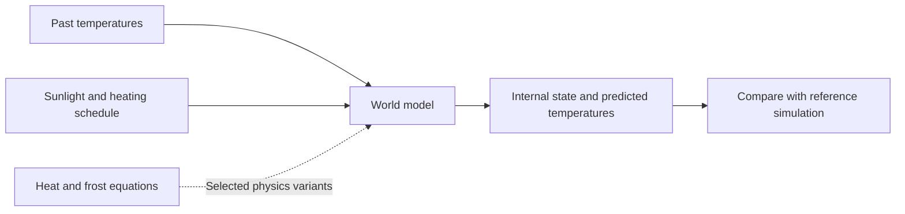

<div align="center">

# MarsWorld

### Physics-grounded world models for Mars-like climate dynamics

Predicting how temperature and CO₂ frost respond to new heating schedules.

[](https://github.com/sameeerkashyap/mars-jepa/actions/workflows/ci.yml)
[](pyproject.toml)
[](https://pytorch.org/)
[](docs/pilot/PAPER_REVISION_PLAN.md)

[Research question](#research-question) · [Methods](#methods) · [Data](#data) · [Getting started](#getting-started) · [Repository map](#repository-map)

</div>

---

MarsWorld studies **whether physical structure and learned memory improve climate
predictions under unfamiliar heating actions**. It combines synthetic climate
experiments, latent prediction models, and comparisons with simpler methods.

The heating pilot divides a Mars-like surface into 64 latitude bands. Sunlight,
dust, underground heat, and CO₂ frost shape the temperature response. Added heat
can turn frost into gas before the surface warms. A useful model must predict
both the response and its timing.

## Research question

> Can a model learn from limited climate simulations and accurately predict the
> response to heating schedules outside its training range?

**Primary hypothesis:** At a fixed training-data budget, physical structure
improves held-out intervention-response prediction compared with an otherwise
matched data-only model.

We also study how the effect changes with observation history, hidden ice state,
training-set size, and rollout length. The comparison separates the effects of
latent prediction, memory, and physics.

| Experiment | Evidence sought |
|---|---|
| Unseen heating magnitudes and schedules | Accuracy of the predicted warming response |
| Smaller training datasets | Error versus number of training trajectories |
| Recursive forecasts | Error growth, physical consistency, and failure rate |
| Physics and memory ablations | Which components explain any improvement |
| Future planning study | Heating cost and outcomes achieved in the reference simulator |

The detailed experiment proposals are in the
[paper revision plan](docs/pilot/PAPER_REVISION_PLAN.md).

## How it works



The model observes a past temperature sequence and receives the future sunlight
and heating schedule. It predicts future temperatures without access to their
true values. Matched heated and unheated simulations measure the effect of the
action.

## Methods

Two world-model implementations are available. The heating comparison uses
**latent JEPA**, which predicts a compact internal state through time. The
**spatial PI-JEPA prototype** uses convolutional encoders and decoders on
separate two-dimensional diffusion fields.

| Architecture | Role | Code |
|---|---|---|
| Latent JEPA | Action-conditioned latent prediction for the heating pilot | [src/models/latent_jepa](src/models/latent_jepa/) |
| Spatial PI-JEPA | Spatial encoding, latent prediction, and physical-field decoding | [src/models/pi_jepa](src/models/pi_jepa/) |
| GRU | Recurrent data-only comparison and no-heating-input control | [benchmarks/gru](benchmarks/gru/) |
| RSSM | Stochastic recurrent state-space comparison | [benchmarks/rssm](benchmarks/rssm/) |
| Transformer | Attention-based sequence comparison | [benchmarks/transformer](benchmarks/transformer/) |
| Hybrid / physics-only | Simplified heat equations with or without a learned correction | [benchmarks/hybrid](benchmarks/hybrid/) |
| Linear | Simple autoregressive comparison | [benchmarks/linear](benchmarks/linear/) |

Selected pilot architectures support physics-residual penalties. The registered
sweep specifies which combinations are evaluated. The
[benchmark registry](benchmarks/registry.py) provides a shared rollout interface.

## Data

**Synthetic data train the intervention models first. ARCO-Mars supplies a
planned, separate test of present-day climate forecasting.**

| Source | Use | Availability |
|---|---|---|
| Synthetic heating trajectories | Train and test responses to controlled heating | Generator, manifest, and specifications included; full trajectory arrays must be recovered or generated |
| Spatial diffusion trajectories | Train and test spatial PI-JEPA ablations | Generated locally with the included solver |
| ARCO-Mars | Check seasonal climate and forecast held-out Mars years | Integration planned |

For the heating pilot:

- **Inputs:** past surface temperatures, sunlight, and the heating schedule.
- **Targets:** future surface temperatures across 64 latitude bands.
- **Hidden diagnostics:** CO₂ ice amount, underground temperature, and dust.
- **Current protocol:** 40 sols of observations followed by a 120-sol forecast.
- **Training range:** 0–5 W/m² of added heating.
- **Stronger-heating test:** 8–10 W/m² in the committed manifest.

A sol is one Mars day. W/m² measures heat supplied per square metre. The generator
retains a historical 7.5–10 W/m² default; use the explicit bounds in the
[pilot guide](docs/pilot/RUNME.md) when reproducing the manifest design.

Read [the simple data and modeling guide](docs/DATA_AND_MODELING.md) for the
training inputs, controls, splits, and role of each data source.

## Getting started

Run from the repository root. Install the model, benchmark, testing, and
documentation dependencies:

```bash
python -m pip install -e ".[dev,docs,benchmark]"
```

The current flat source layout uses `PYTHONPATH=src` for source-tree commands.
The package discovery and pilot root-path settings still need alignment with
this layout before full pilot execution.

### Explore the heating pilot

```bash
PYTHONPATH=src python -m scripts.pilot.gen_data --help
PYTHONPATH=src python -m scripts.pilot.train --help
PYTHONPATH=src python -m scripts.pilot.eval --help
PYTHONPATH=src python -m scripts.pilot.sweep --help
```

The [pilot run guide](docs/pilot/RUNME.md) covers data recovery, generation,
training arms, and evaluation. Specifications are in
[data/specification/pilot](data/specification/pilot/).

### Run the spatial prototype

```bash
# Generate the spatial dataset.
PYTHONPATH=src python -m scripts.generate_data --config configs/pi_jepa/default.yaml

# Train the physics-informed world model.
PYTHONPATH=src python -m scripts.train --config configs/pi_jepa/default.yaml

# Compare with the physics-off ablation.
PYTHONPATH=src python -m scripts.train --config benchmarks/pi_jepa/no_physics.yaml
```

## Repository map

```text
mars-jepa/
├── src/                         Model and simulation library
│   ├── models/
│   │   ├── latent_jepa/         Latitude-band latent world model
│   │   ├── pi_jepa/             Spatial encoder, predictor, and decoder
│   │   └── sequence.py          Shared sequence-model normalization
│   ├── physics/                 Reference simulator, simplified physics, losses
│   ├── data/                    Dataset readers, windows, diffusion generator
│   ├── training/                Spatial-model training loop and objectives
│   ├── config.py                Typed spatial-model configuration
│   └── paths.py                 Shared pilot file locations
├── benchmarks/                  Comparison architectures and scoring
│   ├── gru/  rssm/  transformer/ hybrid/  linear/
│   ├── pi_jepa/                 Spatial-model ablation settings
│   ├── registry.py              Shared model factory
│   └── metrics.py               Polar-winter scoring rules
├── data/
│   ├── synthetic/               Pilot and spatial datasets
│   ├── arco_mars/               Future historical Mars records
│   ├── specification/           Physical settings, split rules, hashes, thresholds
│   └── diagnostics/             Saved simulator checks and logs
├── scripts/
│   ├── pilot/                   Generate, train, evaluate, calibrate, plot, analyze
│   ├── generate_data.py         Spatial data generation
│   ├── train.py                 Spatial model training
│   └── utils.py                 Logging and seed utilities
├── configs/pi_jepa/             Main spatial-model settings
├── tests/                       Model, data, physics, CLI, and layout checks
├── docs/                        Research plans, architecture, and run guides
├── paper/                       Original position-paper draft
├── k8s/                         Container and Kubernetes jobs
└── outputs/                     Generated pilot results; ignored by Git
```

`src/data/` contains reader and generator code. Top-level `data/` holds dataset
files and their specifications. Large arrays and generated outputs stay outside Git.

## Research status

Implemented: reference physics, synthetic generators, world models, comparison
architectures, training and evaluation tools, and automated checks.

Next: align the flattened source paths, recover the full heating dataset, run the
controlled model comparisons, and add ARCO-Mars climate checks. The current
heating simulator holds pressure at 610 Pa; variable-pressure predictions require
coupled atmospheric CO₂ mass dynamics.

## Documentation

| Guide | Contents |
|---|---|
| [Data and modeling](docs/DATA_AND_MODELING.md) | Plain-language explanation of the problem and training data |
| [Paper revision plan](docs/pilot/PAPER_REVISION_PLAN.md) | Hypotheses, evidence review, proposed experiments |
| [Pilot run guide](docs/pilot/RUNME.md) | Data recovery, generation bounds, training, evaluation |
| [Architecture](docs/architecture.md) | Spatial PI-JEPA components |
| [Scripts](scripts/README.md) | Commands and utilities |
| [Data specifications](data/specification/README.md) | Settings, split definitions, hashes, thresholds |
| [Kubernetes](k8s/README.md) | Container and cluster execution |

For local verification, use `python -m pytest -q`, `ruff check src scripts benchmarks tests`,
and `python -m mkdocs build --strict` after the source-layout settings are aligned.
