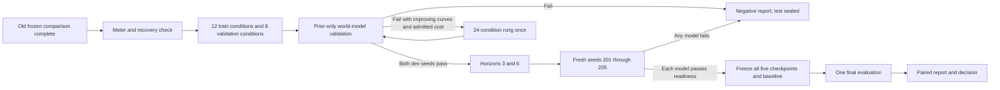

# Cost-gated Dreamer response-control pilot

The controller runs the relative +2 K task. It preserves the negative absolute
frost-target record. It uses the existing CPU learner and exact heat/time
imagination adapter. It does not use the old forecast test results for tuning.

The fixed recipe is in `data/specification/pilot/dreamer_control.json`.
The worker is `scripts.pilot.dreamer_control_worker`. The durable controller is
`scripts.pilot.dreamer_control`. No new dependency is required.



## Data and validation

`data.control.generate_dataset` generates four schedules for each condition.
Only `episode['policy']` enters Dreamer replay. Hidden response labels remain
in the data pipeline and validation scoring. They do not enter the policy,
encoder, actor, recurrent belief, or prior forecast.

The first rung has training conditions 5000–5011 and validation 5100–5107.
The one permitted data expansion uses 5000–5023. All schedules for one
condition remain together. Conditions 5200–5219 stay sealed until the five
confirmation checkpoints and the baseline are frozen. Conditions 9000–9999
remain reserved.

The world-model search compares only learning rates 4e-5 and 3e-4, each with
initialization seeds 101 and 102. Capacity remains 64. Model updates stop at
2,000, with the normal 1,000-update optimizer warmup. Validation checkpoints
are 500, 1,000 and 2,000 updates. The checkpoint with the least South response
RMSE is selected. No actor or critic update occurs in this stage.

A forecast conditions on the reset observation once. Each later state uses
the prior and the applied action. Future observations and response labels are
score labels only. Report South response and full-field temperature RMSE at
10, 30, 60 and 120 sols. Report integrated reward prediction RMSE. Compare with
zero response, temperature persistence and a training-only fitted linear
response recurrence. Both development seeds must beat the better response
baseline by at least 10%, beat the better reward baseline, and do no worse
than temperature persistence. These thresholds are declared before launch.

If readiness fails, one 24-condition rung is allowed only when both seeds of
the selected recipe improve their response RMSE by at least 10% between
updates 1,000 and 2,000, and the full added stage passes cost admission.
Otherwise the report is negative and the test remains sealed.

Behavior search compares horizon 3 with horizon 6, each on seeds 101 and 102.
It starts from that seed's best validation model checkpoint. Each seed must
pass its own readiness check before any actor update. Behavior checkpoints
are 100, 200 and 400 updates. Collect one training episode every 20 updates.
Select the horizon by mean validation episode RMSE. A seed that fails model
readiness is retained as a failed scientific candidate; it is not replaced.

The final five seeds, 201–205, each initialize and train the complete selected
recipe afresh. Each seed must pass its own model gate. Select each behavior
checkpoint on validation only. No selected development weights are counted
as fresh confirmation weights.

## Baselines and final gate

Eligible baselines are no heat, constants 1.5, 2, 2.25 and 2.5 W/m², a fixed
late-season pulse, observable temperature-change feedback, and a simple-model
plan. The simple model fits a response recurrence using training data only.
One bounded SLSQP solve chooses twelve actions from its own daily interpolated
predictions, with the 0–10 action cap and 300 total heat allowance. It makes no
future truth call. Validation truth chooses the baseline with the least mean
RMSE. Freeze its name, fitted coefficients and action plan. Truth-simulator
search remains a privileged reference and is excluded from baseline selection.

The final worker verifies all five source, configuration, dataset and checkpoint
hashes before it opens any final condition. Its exclusive
`EVALUATION_STARTED.json` prevents a second evaluation after partial failure.
It retains each seed result and daily whole-field trajectories on the PVC.
A failed held-out job is not retried or resampled.

The gate is `1 - mean(all five seed RMSE means) / baseline RMSE mean >= 0.10`.
It also requires no heat/time violations and all identity checks to pass.
The report includes all seeds and conditions, heat use, constraint violations,
whole-field temperature summaries, and paired hierarchical bootstrap uncertainty
(10,000 draws, seed 6100). A failed gate is a valid negative result.
A passed gate adds a costed larger-data proposal. It does not authorize it.

## Cost and recovery

Jobs request two CPU cores. Dataset manifests record that allocation and stage
wall time; process CPU time is separate. `Study.account` charges full Job
occupancy from Pod allocation through container completion, including startup.
The controller imports the previous complete cumulative ledger once and pins
its hash. It adds a rounded conservative 0.25 CPU-core-hours for local feasibility and metering.
The shared cap remains 48 CPU-core-hours and 12 GPU-hours. This learner has no
GPU admission path. At most two study workers may be active globally.

Cost estimates use target-runtime generation, model-update, synthetic behavior
update, collection and forecast-validation measurements. Admission adds a
1.5 multiplier and startup allowance. Cost blocks new work only. Running Jobs
have no deadlines, timed deletion or elapsed-time stop rule.

Replay, optimizer warmup, random-number states, source/config/data identities,
CPU stack and thread count, learning curves and the condition cursor live in
one atomic recovery checkpoint. Recovery discards work since the last saved
checkpoint and replays the same seed cursor. Validation reuses private
per-condition simulator checkpoints within a worker to avoid repeated spin-up;
only current public observations reach the policy.

The controller retains its immutable source archive, state, allocation evidence,
logs, frozen manifest, report and blocker on the local project path. Model
checkpoints, raw data, curves and final trajectories remain on
`marsworld-pilot-sweep`, under `/results/mars-dreamer-ctrl-v1`.
Use a persistent local process, with absolute paths to the previous state:

```sh
rtk env PYTHONPATH=src:. TMPDIR="$PWD/.cache/pilot-tmp" \
  /path/to/.venv-torchrl/bin/python -u -m scripts.pilot.dreamer_control \
  --state-dir /absolute/project/outputs/pilot/mars-dreamer-ctrl-v1 \
  --previous-state /absolute/project/outputs/pilot/torchrl-comparison-v1/state.json
```

The driver waits for the existing frozen comparison to complete. It does not
change its source, data, checkpoints, frozen decision, or running Jobs. A local
launcher lock prevents duplicate controllers. Reuse the same state path after
an API interruption. Completed results are reused; failed tasks require review.

## Local checks and protocol deviation

A disposable local meter initially ran twelve climate actor timing updates plus recovery checks before the
readiness guard was corrected. No Nautilus Job was launched. Those weights were
not selected, promoted, or used for confirmation or final evaluation. That run
is a protocol deviation, not learned-control evidence. It used 15.3529 wall
seconds at two allocated cores. A later loader probe failed after 10.8221 wall
seconds. Prior feasibility used 0.14951 CPU-core-hours. Its cost is covered by
the conservative local allowance. The corrected meter uses synthetic vectors
for all behavior timing and recovery checks; physical replay receives only
model-only updates before readiness.

Local tests cover prior-only forecasting with poisoned future labels, untouched
forecast RNG, data allocation metadata, cumulative cost import, stage ordering,
per-seed readiness, five-checkpoint verification before test access, exclusive
final evaluation, report arithmetic and bootstrap pairing. These checks do not
establish target-cluster performance or learned control success.
