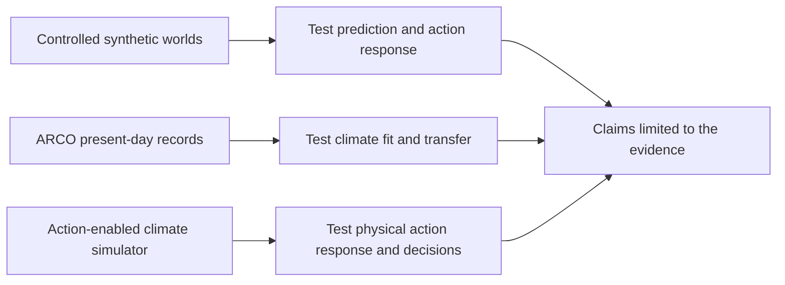
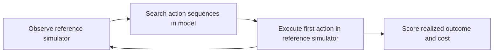

# Mars world-model paper: evidence review and experiment plan

> Folder update: commands are in `scripts/pilot/`, model comparisons in
> `benchmarks/`, physics and readers in `src/marsworld/`, and specifications
> in `data/specification/pilot/`. See [the current run guide](RUNME.md).

Date: 2026-11-08. Branch: `research/mars-paper-revision`.
Base: `origin/akshitha` at `a39df0c`, including the new JEPA arm and registered thresholds.

This document reviews the supplied 12-page paper, the pilot code, and primary external sources. The rejection reason comes from the author's message. The full reviews were not supplied. Proposed experiments below have **not** been run. No acceptance or novelty claim follows from this plan.

## 1. Recommendation

Keep the Mars motivation. Replace the claim that one architecture is the right foundation with a question that experiments can answer:

> When does incomplete physics improve action-conditioned prediction, and when does it make prediction and planning worse?

An action-conditioned model predicts what happens after a specified action. In the pilot, the action is added heat. It is not yet a greenhouse-gas release, a mirror deployment, or an aerosol injection rate.

The current data are suitable for a controlled test of learning methods. They are not validated measurements of Mars. ARCO-Mars can supply a present-day climate test. It cannot supply the missing response to terraforming actions. A claim about useful intervention planning needs an action-enabled reference simulator and policy evaluation in that simulator.



The smallest defensible revision is an empirical study of failure and success under incomplete physics. A broader terraforming paper needs the third evidence source. More model components alone will not answer the rejection.

## 2. Is the synthetic data accurate?

There are three different questions. Passing one does not answer the others.

| Question | Current evidence | Judgment |
|---|---|---|
| Does the code solve its stated equations? | Conservation, frost, determinism, and simulator-agreement tests exist. Stored diagnostic reports exist. | Promising internal checks; not re-run in this review. |
| Do those equations match present-day Mars? | No held-out observation or reanalysis comparison found in this pilot. Several parameters are explicitly uncertain or tuned. | Accuracy is not established. |
| Do the equations predict engineered warming on Mars? | One uniform heat input; fixed pressure; no engineered-particle, gas, or mirror model. | Not established; several requested outcomes cannot be represented. |

### Useful parts to preserve

`common.py` uses an area-aware latitude grid, seasonal sunlight, conservative heat exchange between bands, and latent heat for CO2 frost. `sim_truth.py` includes a second heat reservoir below the surface and a random dust process. `gen_data.py` gives each forced trajectory a control with the same initial state and storm seed. This reduces noise when measuring the action response.

The loaders distinguish inputs, evaluation answers, and hidden simulator states. Splits use disjoint trajectory seeds. These are good controls for an ML benchmark. They do not validate the physical assumptions against Mars.

### Main physical limits

1. **Pressure stays fixed at 610 Pa.** Ice can form without reducing atmospheric CO2 or pressure. Thus the model can conserve its heat budget without conserving a finite atmosphere-plus-ice CO2 inventory. It cannot predict pressure growth. Keep it as a fixed-pressure approximation, or add coupled atmospheric mass and frost-point updates before making pressure claims.
2. **Dust only reduces incoming sunlight in this model.** There is no atmospheric dust heating, downward infrared feedback, wind response, or dust transport. This is insufficient for a general dust or engineered-aerosol warming claim. `exp(-tau)` is a simple attenuation rule, not a full radiation model.
3. **Mars has only a north-to-south dimension.** There is no longitude, height, terrain, wind field, or day-night cycle. A 64-band surface model cannot verify hydrostatic balance or 3-D circulation.
4. **The transition was deliberately placed near the training boundary.** `D=0.10` was selected to make the south-pole frost response difficult. This is a designed test case. The approximate 5–6 W/m² transition is not a measured Mars threshold.
5. **One knob changes both dust and underground heat exchange.** `mismatch_scale` changes the reference climate itself. Comparing 0.10 and 0.25 does not isolate how wrong the learner's physics is. Keep the reference world fixed and vary omissions in the learner separately.
6. **Ice amount is resolution-sensitive in the stored design notes.** Convergence of one warming threshold does not establish convergence of cap mass, cap edge, or policy ranking. Recheck all headline outputs at finer grid and smaller time step.
7. **Temperature can hide important state.** Many ice masses can have the same frost-point temperature. Forty sols of temperature need not identify that mass. A stochastic latent state cannot recover information absent from the observations; it must represent uncertainty over possible states.

```text
Same measured temperature, different hidden ice

thin ice  + heat  -> ice is gone early -> warming starts early
thick ice + heat  -> ice remains       -> warming starts late

A model must infer ice from enough history, observe it,
or keep uncertainty about the amount. Temperature alone is not enough.
```

Do not reuse the cap-size reference numbers in the old PREREG as established facts. That file itself says they were recalled from memory and remain unverified.

### Code and protocol issues to resolve before a large sweep

| Evidence in the current code | Consequence | Required check or change |
|---|---|---|
| `gen_data.py` defaults Tier 2 to `[7.5, 10]`; the tracked manifest and PREREG D5 specify `[8, 10]`. | A default regeneration can silently use a different experiment. | Use one explicit versioned specification; assert manifest bounds against it. |
| `config.yaml` defaults to mismatch 1.0; generation overrides it to 0.10. | A direct simulator call can use a different world from the dataset. | Record resolved configuration and hashes for every run. |
| Hybrid/EBM-only advance by the stored interval, one sol. The reference simulator uses 0.05-sol steps. | Numerical error can be mistaken for an effect of the learned correction. | Compare both integrators at matched substeps and measure sensitivity before attributing gains. |
| `EBMResidual` masks cells using predicted temperature and omits latent heat there. | The score misses the main phase-change process. Coverage could shrink with poor predictions. | Report valid-cell coverage and below-frost errors; add independent heat/ice checks. A lower training residual is not independent validation. |
| Hybrid ice starts from a fixed sentinel mass when the last temperature is near frost. | Release timing can be wrong before learning even begins. | Compare fixed mass, inference from past context, and true-ice initialization as a labeled oracle. Never give the oracle state to the main models. |
| Tier 1 uses step/pulse inputs; Tier 2 uses constant inputs. | Their error ratio combines a shape change and a magnitude change. | Add same-shape in-range and out-of-range tests; retain the original score as a legacy measure. |
| Forecast context is taken from an already forced trajectory. | A model may see the effect before the forecast starts. | Report separate tests from before action onset and after action onset. A constant action after 40 sols is not a test of choosing a new action. |
| `sweep.py` uses a fixed default physics weight. `train.py` has a separate selection path. | A documented validation search is not necessarily the search used by the sweep. | Freeze a fixed weight or run equal-budget validation selection explicitly. |
| `analyze.py` chooses the best pure arm using the test metric for one H3 route. | The comparator depends on test outcomes. | Select it on validation, or use a simultaneous comparison procedure that accounts for selection. Preserve the old protocol and log the amendment. |
| The ten sweep seeds change fitting/subsampling on one generated main dataset. | They do not measure uncertainty over independent generated training datasets. | Separate dataset, model-initialization, and test-trajectory variation. Do not count overlapping forecast windows as independent samples. |

The newer branch **does** contain fixed thresholds and a statistical procedure in `thresholds.yaml`. The previous explanation that all thresholds remained blank is now out of date. Several old document headers are still stale. Preserve D1–D10 and add a dated amendment; do not describe a revised test as untouched pre-registration.

The tracked manifest lists 210 trajectories, each with 2,006 stored times. No trajectory NPZ files are present under `data/` in this checkout. The manifest and `DATA_SHA256.txt` document a dataset; they do not supply it. `regression_ref.npz` is a separate regression artifact.

## 3. How ARCO-Mars can help

[ARCO-Mars v1](https://arxiv.org/html/2606.21701v1) packages EMARS, MACDA, and OpenMARS reanalysis in cloud-readable Zarr stores. Reanalysis combines observations with a numerical model; it is not direct measurement everywhere. Products have different variables, gaps, and assimilation methods. They also share observations and, in some cases, related model physics. Agreement is useful evidence, but not three independent ground truths.

These records describe historical Mars, not randomized terraforming actions. They can support climate checks, representation learning, and forecasting. They cannot establish the causal effect of an engineered intervention. EMARS spread is a reanalysis uncertainty estimate, not a complete uncertainty model for future engineered Mars.

### A verified starting point

I fetched the live [ARCO-MACDA root metadata](https://huggingface.co/datasets/ananyo01/ARCO-MACDA/raw/main/macda_combined.zarr/zarr.json). This checks the archive interface, not the accuracy of its array values.

| Field | Live metadata |
|---|---|
| Format | Zarr v3, consolidated metadata |
| Surface dimensions | `time, lat, lon`: `96480 × 36 × 72` |
| Surface chunks | `120 × 36 × 72` |
| `tsurf` | Surface temperature, K, float32 |
| `co2ice` | Surface CO2 ice amount, kg/m², float32 |
| `psurf` | Surface pressure, Pa, float32 |
| `coldust` | Visible dust optical thickness, dimensionless, float32 |
| Time warning | Units say `days since 0001-01-01`; the description says Martian sols; calendar is `none`. Verify numeric cadence before decoding. |

Each of these full surface fields is about 1.0 GB uncompressed. One 120-time chunk is about 1.24 MB before compression. Read selected chunks, not the full archive by default. The Hugging Face tabular preview reports an error; that is not proof that the Zarr store is unusable.

Metadata SHA-256 on review date: `3a33270d20e3ef4e518b0d1a359c51d5a0554d10ec4f1e29d041a099e3c19248`. Pin a repository revision for experiments. A moving `main` URL is not a reproducible data release. Array chunks were not downloaded or tested here.

### Proposed use 1: test the present-day climate

Start with MACDA because the inspected metadata includes the pilot's surface variables. Check every variable's meaning; do not substitute near-surface air temperature for ground temperature. The metadata define `coldust` at a particular visible wavelength. Do not mix it with infrared or pressure-normalized dust opacity without a documented conversion.

1. Read coordinates, a short time range, and only required surface variables. Verify units, missing values, time cadence, solar longitude, and Mars year labels.
2. Compute daily means that cover all available local times before making longitude means. A snapshot across longitudes samples different local times. Check sampling coverage.
3. Regrid by cell area to the pilot's equal-area bands. Use cell boundaries where available. Do not interpolate polar averages as if all latitude rows had equal area.
4. Compare the seasonal temperature cycle by latitude, polar winter temperatures, ice season and cap area, dust seasonality, and pressure seasonality. Fixed pressure is an explicit failure of the current toy for the last item.
5. Fit a small declared parameter set on training years only. Freeze parameters. Report errors on later years and on a second product. Reserve a whole dust-storm year as a stress test if coverage supports it.

Report bias and RMSE in K, cap area and timing errors, and pressure errors in Pa. Set tolerances before the final test using observational uncertainty, product disagreement, and a planetary-science review. The present review does not supply evidence-based accuracy tolerances.

### Proposed use 2: test present-day forecasting and transfer

Use whole Mars years for splits. Verify the common valid years before fixing their exact IDs. Exclude documented forecast-only gaps from the main observation-constrained score; report them separately. A transfer test between MACDA and OpenMARS is useful but partly shares model ancestry. EMARS adds a different modeling system, though it still shares some observations.

Compare persistence, a training-only seasonal climatology, a linear anomaly model, GRU, and the selected world model. Predict 1, 10, and 30 sols initially. Add longer horizons only after this test works. Train normalization on the training years only. Report performance in physical units, not only normalized loss.

Pretraining a compact encoder on these records is an option. Compare it with random initialization using identical synthetic training budgets. Separate predictors supplied with future dust from predictors that must forecast it. Future historical dust is unavailable to a real planner.

### What cannot be inferred

Do not label a historical dust storm as a greenhouse-gas action. Do not set artificial action labels on passive records and claim identified intervention effects. Do not infer a new warming threshold by adding heat to a reanalysis snapshot without a simulator that evolves the changed state.

The [MCD access notes](https://www-mars.lmd.jussieu.fr/mars/access.html) describe averaged and interpolated model output. MCD is useful for background climate and initial conditions. A sequence of database queries is not an action-responsive trajectory. It cannot replace coupled intervention simulations.

## 4. What must change in the supplied paper

The draft combines several established components: a latent encoder, RSSM, physics losses, a learned differential-equation correction, and an actor-critic planner. Their combination is a proposal. Neither architectural detail nor a Mars application establishes original empirical value by itself.

| Draft location | Problem | Revision |
|---|---|---|
| Title and abstract, p. 1 | Declares the preferred architecture without Mars comparisons. | Use a question or an empirical scope: **“Testing Incomplete Physics for Action-Conditioned Mars-Like Climate Models.”** Broaden the title only when broader tests exist. |
| Abstract and Table 1, pp. 1, 4 | Marks the proposed system as satisfying untested requirements. | Use “proposed” or “not measured.” Separate measured properties from goals. |
| Sections 2–3 | Says climate emulators lack action-conditioning and GCMs cannot accept sequential interventions. | Distinguish historical forcing response, programmable simulator forcing, and learned sequential planning. The absolute exclusions are not defensible. |
| Section 4.1 | Proposes MCD samples as synthetic intervention rollouts. | Use MCD for climatology; generate action-response data with a time-evolving simulator. Give each source's variables and gaps separately. |
| Section 4.2 | Calls loss penalties hard constraints. | Call them soft penalties. Reserve “hard” for an update or parameterization that guarantees a constraint. Apply physical checks to decoded fields or a defined physical state, not an arbitrary latent vector. |
| Equations 1–3, p. 6 | Hydrostatics, mass, and phase change do not match the pilot state. | Drop hydrostatics from the 1-D surface study. In a pressure model, conserve total CO2 across atmosphere and ice, plus action sources/sinks. A local column mass is not constant under transport. Treat frost equilibrium as an explicit approximation. |
| Section 4.3 | Claims discrete RSSM latents improve century stability and recurrent models handle scarcity better. | Treat these as hypotheses. Current pilot RSSM uses Gaussian latents, so it does not test the discrete-latent claim. Transformers can also have probabilistic outputs. |
| Section 4.4 | Uses oxygen and pressure rewards without modeled chemistry or variable pressure. | Remove these rewards from the pilot. Use a bounded temperature objective and heating cost. Add outcomes only when their dynamics exist. |
| Section 4.4, p. 7 | Calls about 30 kPa the Armstrong limit. | Remove the human-survival claim. The Armstrong limit is about 6.3 kPa, and exceeding it does not establish habitability or breathable air. See the [UBC physiology reference](https://www.eoas.ubc.ca/courses/atsc113/flying/met_concepts/02-met_concepts/02b-oxygen_physiology/index.html). |
| Section 5.2 | Executing a whole precomputed action sequence is called closed-loop evaluation. | Call it open-loop sequence transfer. For closed-loop evaluation, read new reference-simulator observations and replan after each action. |
| Sections 5–8 | Benchmark, long horizons, and policy benefit remain prospective. | Release an executable task, data provenance, baselines, and results. Keep centuries and full terraforming in future work. |

Also correct the p. 1 date inconsistency: the text says Artemis II completed its journey on April 1 while its own reference describes April 1 as launch and April 10 as splashdown. Remove the anecdote if it is not needed. Audit citations, numbers, and architecture descriptions before resubmission; a full citation audit was not performed here.

### Prior work changes the novelty argument

[ACE2](https://arxiv.org/abs/2411.11268) already studies forced atmospheric response and conservation. It also reports limits when forcings are changed separately. Thus the gap is reliable response under specified shifts, not the complete absence of forcing-aware climate emulation.

[Causal Climate Emulation with Bayesian Filtering](https://arxiv.org/abs/2506.09891) already studies stable autoregressive climate emulation with physically based causal structure. Compare its assumptions and evaluation with the proposed work before claiming a new causal world-model framework.

[Richardson et al. (2026)](https://doi.org/10.1029/2025GL121051) modify MarsWRF to model engineered particles released at the surface, their transport, and warming feedbacks. This directly challenges the draft's claim that GCMs cannot model intervention inputs. The useful ML question is whether a surrogate can reproduce and optimize such action responses at lower cost.

These sources are enough to reject the broad absence claims. They are not an exhaustive novelty search. A revised paper needs a targeted comparison with existing physics-guided emulation, latent-state inference, system identification, and model-based control work.

## 5. A contribution that experiments could establish

Use one main contribution, with a result that can be negative:

> A controlled map of when incomplete physics helps or hurts action-response prediction across a hidden phase-change state, with climate checks and decision tests.

This is a proposed empirical contribution, not an established first. It becomes useful if the results reveal a reproducible boundary that simpler baselines do not already explain.

Hold the reference climate fixed. Change three factors independently:

| Factor | Example levels | What it tests |
|---|---|---|
| Missing physics in the learner | Full reference equations as an oracle; omit dust; omit underground heat; omit both | Whether a physics prior helps because it is informative, or hurts because it is wrong |
| Visible history | 10, 40, 160 sols; temperature only versus temperature plus ice | Whether memory is needed, and whether the hidden state can be inferred |
| Action shift | New magnitude; new timing; new schedule; then combinations | Which kind of generalization fails |

Add a same-temperature/different-ice test. Prepare two physically reachable states with closely matched observed temperature context and different ice inventories. Apply the same heating. Measure different release times. This makes the role of hidden state explicit. Report uncertainty when the context is insufficient. An oracle with true ice gives a useful upper bound; it is not a fair main competitor.

One optional method is an inferred-ice hybrid. Replace only the fixed sentinel ice initialization with a nonnegative estimate from context. Compare it with fixed-ice, longer-history, and oracle variants. Evaluate inferred ice against hidden simulation labels held out for diagnostics. If the method adds no skill over a simple state estimator, remove it. This is standard latent-state estimation until evidence and related-work analysis show a distinct contribution.

Do not add a large actor-critic system merely to preserve the draft. Start with a small action search and test whether predictions lead to better decisions.

## 6. Experiment sequence and required evidence

### E0. Recover and validate the experiment assets

Recover the generated arrays and verify their hashes. Reconcile the generation defaults, manifest, thresholds, and documentation. Create a new dataset version for any changed protocol. Keep the old version for reproducibility. Test the default loader's hidden-label exclusion and all new split guards.

Run existing physics and model tests in a declared environment. Check grid/time-step convergence, spin-up convergence at the actual scale 0.10, matched control storm paths, and integrator agreement. Store effective configuration, code revision, seed roles, and all failures.

**Required artifact:** a data card and a numerical validation table. Passing these checks establishes internal consistency, not real-Mars accuracy.

### E1. Establish skill on the existing action task

Reuse GRU, RSSM, Transformer, JEPA, GRU plus strict physics loss A, and hybrid. Keep persistence, seasonal climatology, ridge, physics-only, and `gru_noforce` as controls. A simple reduced-state estimator is especially relevant to the hidden-ice task. A Gaussian-process or reduced-order surrogate can accept lagged state and action; do not dismiss it as incapable in principle.

Use the registered fractions 0.1, 0.3, and 1.0. Match information, validation search budget, and training budget. Report parameters and wall time. Parameter count alone does not match computation. Keep variant B separate: it gets physics evaluations under out-of-range inputs. Include a baseline with the same input access and equal extra compute if claiming a benefit from physics rather than extra optimization.

For the first revision, one full registered sweep can establish a pilot result. For a stronger general claim, use independent generated training replicas. A proposed confirmation grid is six learned variants × three fractions × five dataset replicas × three initialization seeds = **270 fits**, plus controls. This is a design count, not a measured runtime estimate. Run a small development subset first; measure cost before committing to the full grid. Do not use final-test scores to choose that subset's winner.

**Required artifact:** per-trajectory response errors, error versus forecast length, data-efficiency curves, uncertainty intervals, and failures. A consistent null result is reportable.

### E2. Explain the mechanism and failure boundary

Run the missing-physics, history, and visible-ice comparisons above. Evaluate matched action shapes across magnitude ranges. Add action-start, turn-off, and delayed-start tests with reserved seeds. Compare unpinning time, frost violation rate, and response RMSE. Show both hemispheres, all polar-winter cells, and the registered control-pinned subset.

Reserve a second reference parameter setting before final evaluation. This tests robustness to the deliberately tuned transition. Describe it as a different reference world. Separately change learner physics while holding that world's reference parameters fixed. Avoid interpreting one as the other.

**Required artifact:** a plot with prior error on one axis, action shift on the other, and skill relative to a data-only baseline as color. A region where physics hurts is informative. Do not tune it away.

### E3. Add the ARCO climate and transfer tests

Implement the aggregation and whole-year split checks in Section 3. Compare the uncalibrated toy, a training-years-only fitted toy, and simple forecasting baselines. Use a second reanalysis product for a qualified transfer check. Independent retrievals or rover records held out from fitting would strengthen the validation further; check their assimilation overlap before calling them independent.

**Required artifact:** seasonal temperature/ice comparisons and held-out forecasting scores. Do not require the toy to match every field before it can be used as a controlled benchmark. Instead, show which climate features it captures and restrict the physical claims accordingly.

### E4. Measure decision quality in the reference simulator

Use a bounded heat budget and a short-horizon temperature target. Choose actions every 10 sols initially; test another interval for sensitivity. Compare no action, equal-budget constant heating, seasonal heating, direct search using the simple physics model, and search using each learned model. On the cheap toy, also run an equal-budget reference-simulator search as a labeled planning benchmark. It is not a guaranteed optimum.

Use the same planner and candidate budget across learned models. A small random-shooting or cross-entropy planner is enough. Execute the first action in the reference simulator, obtain a new permitted observation, then plan again.



Report realized temperature benefit, action cost, constraint failures, and the difference between predicted and realized utility. Report regret relative to the reference search's achieved score, without calling that score a true optimum. Include state and parameter shifts. A model with lower RMSE can still choose worse actions; that would be an original empirical finding if it is robust and properly situated in prior work.

**Required artifact:** actual reference-simulator outcomes, not only rewards predicted by the learned model.

### E5. Add a physically specified intervention test for broader claims

For a paper centered on terraforming, use one intervention family first. Choose a source that contains actual action-response trajectories, then document the source terms, units, lag, limits, and conservation equations. A uniform W/m² action must remain labeled idealized heating.

The [2024 nanoparticle paper](https://pmc.ncbi.nlm.nih.gov/articles/PMC11305381/) links additional 3-D output at [Zenodo](https://doi.org/10.5281/zenodo.8352416). It says MarsWRF source access requires scientific review and an agreement. The 2026 particle-transport study offers a more directly action-related reference. Inspect release licenses, time sampling, action coverage, and available fields before selecting either. Published equilibrium summaries or figure output may not contain enough sequential trajectories for learning or closed-loop testing.

If archived data are too sparse, generate or obtain paired no-action/action runs from an accessible climate model. Benchmark one run first. Estimate total core-hours from that run, including spin-up and storage. Simulator setup, radiative intervention implementation, and access may dominate this effort; no fixed runtime is justified yet.

Use new action amplitudes and schedules for testing. An external simulator family is stronger than a second seed in the training simulator. If only one family is available, state this limit and use withheld parameterizations. Do not describe reanalysis transfer alone as independent intervention validation.

**Required artifact:** a named physical action, reproducible teacher configuration, held-out response errors, and teacher-executed decision results. Without it, keep the paper's core claim at Mars-like controlled prediction.

## 7. Statistical and reporting rules

Keep the current registered thresholds as the original protocol. Add a separate dated revision for the expanded study. Disclose that simulator outcomes informed the original range and metric. Keep development data separate from the revised final test.

- Use the same test trajectories for paired model comparisons. Report effect sizes and 95% intervals, not only p-values.
- Treat full trajectories or whole Mars years as sampling units. Forecast windows overlap and are not independent. Separate dataset replicas and fitting seeds in a hierarchical summary.
- Keep the registered one-sided Wilcoxon/Holm procedure for its stated hypotheses; use a declared new procedure for new comparisons. Do not silently merge the studies.
- Choose model architecture and physics weight on validation data. Do not select a “best” model on the test data and then test it as if it had been fixed beforehand.
- Report numbers of valid windows/cells, missing scores, unstable runs, and excluded cases. Never silently drop failed runs.
- For stochastic predictions, report coverage, interval width, and a proper score such as CRPS. A random latent variable does not guarantee calibrated uncertainty, especially outside the training range.
- Evaluate conservation with independent diagnostics. When hidden reference states are used for an oracle or a diagnostic, label that use and keep them out of ordinary model inputs.
- Measure prediction throughput and planning cost at matched horizon, batch size, hardware, and accuracy. Include training and reference-data generation cost. A cheap 1-D simulator may beat a neural model; report that result if it occurs.
- Bound rollout claims by the longest measured test. A finite stable trajectory is not a century-scale guarantee.

## 8. What is enough for a revision?

| Revision scope | Minimum evidence | Claim it supports |
|---|---|---|
| Focused empirical pilot | E0–E2; strong controls; released results and failure analysis | Learning and phase-change extrapolation in a controlled Mars-like system |
| Stronger empirical paper | E0–E4, including ARCO checks and genuine feedback planning | Climate-linked evaluation and decision utility inside a stated simulator class |
| Broader Mars intervention paper | Above plus E5 and adequate physical validation | Useful surrogate behavior for a named modeled intervention, within tested regimes |

These are evidence levels, not acceptance guarantees. ARCO alone removes neither the missing intervention data nor the novelty burden. A benchmark earns value through a clear failure mode, strong controls, reproducible assets, and a finding that changes what the reader should do.

A practical revised paper can use four main figures: (1) synthetic climate versus held-out seasonal records, (2) action-response skill and data efficiency, (3) the incomplete-physics failure map with ice-history controls, and (4) realized policy outcome versus predicted outcome and compute cost. Keep detailed architecture and legacy design notes in the appendix.

## 9. Implementation order and change scope

No simulator or training code was changed in this review. Implement the next work in small steps:

| Step | Existing places the change must reach | Verification |
|---|---|---|
| Reproducible generation | `gen_data.py`, manifest, hashes, `RUNME.md`, split tests | Default bounds agree; arrays and configuration match hashes |
| Fair physics comparison | `physics_torch.py`, hybrid initialization, `train.py`, physics tests | Matched integrator steps; no hidden-state leakage; valid-mask coverage |
| Independent replica analysis | `sweep.py`, `analyze.py`, thresholds, output schema, analysis tests | Replica/initialization IDs remain distinct; paired and missing-run handling |
| ARCO experiment | New small loader/aggregation experiment; reuse existing model interface where meanings match | Time, units, areas, gaps, variable semantics, and whole-year split fixtures |
| Decision test | Small experiment runner using existing `rollout` and `run_truth` | First action executed in reference model; new observation used on each replan; equal budgets |
| Physical intervention | Selected teacher model and action source implementation | Conservation, unit checks, no-action recovery, timestep sensitivity, held-out responses |

Skip large new model stacks until E1 and E2 show what is missing. Skip oxygen, multiple intervention families, century-scale claims, and actor-critic training in the first empirical revision. Preserve those ideas as future work.

## 10. Review provenance and limits

The supplied PDF's extracted title is *World Models Are the Right Foundation for Simulating Mars Terraforming*. File: `World_Models_for_Terraforming_Mars___NeurIPS_Position2026.pdf`. SHA-256: `1d5b56b0229492978dab959dc18533913382cc7c3bd069d836b27bcd45e611cb`.

Inspected code includes the reference and simplified simulators, shared physics, generation, live manifest, residual/backbone, hybrid and JEPA models, training/sweep/analysis paths, threshold file, physics tests, metric definitions, and design notes. External sources are linked beside the claims they support. The ARCO paper's access example was checked against live consolidated MACDA metadata. No full arrays, model training, GCM build, physical calibration, or experiment results were produced in this task.

The local Python environment lacks PyYAML, PyTorch, pytest, and Zarr. Existing tests were read, not executed. This is a research and revision plan, not a numerical validation report. The main unresolved risk is transfer from a designed fixed-pressure toy to an atmosphere whose mass, radiation, and circulation change under intervention.
